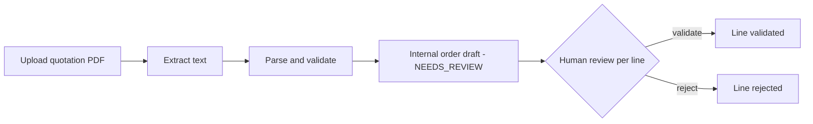
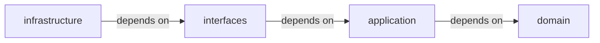
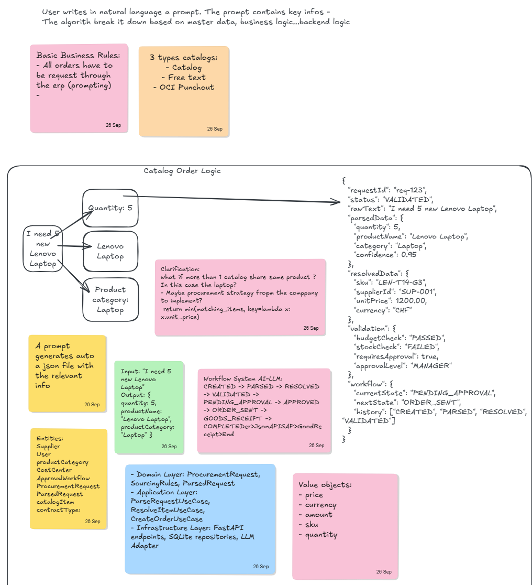

# procAi

[](https://ai-sdlc.aisl.science)
[](https://github.com/ElpiLab/Orchestration-Procurement-main/actions/workflows/ci.yml)

**From supplier quotation PDF to a reviewable internal order draft, with a human in the loop.**

A minimal FastAPI application that demonstrates Clean Architecture, spec-driven development and an AI-assisted lifecycle on a deliberately small use case.

- Capstone project of the FHNW module *AI-assisted Software Development* (BSc Business Information Technology, team of two)
- Created from the [AI-SDLC project template](https://github.com/AIaSDev/ai-sdlc-template)
- README structure follows the template and the reference implementation [BAIssue](https://github.com/AIaSDev/BAIssue)
- Method documentation: [AISL Docs](https://docs.aisl.science/learning-and-resources/ai-sdlc)

> [!NOTE]
> The process matters more than the application: specification, decisions and tests are as much part of the result as the code.

## Getting started

1. Clone this repository and open it in VS Code or GitHub Codespaces.
2. Run the [agent setup](#agent-setup) below.
3. Read `docs/PROJECT.md` (context, architecture, commands) and `AGENTS.md` (lifecycle rules).
4. Install the dependencies and start the application (see [Running locally](#running-locally)).
5. Upload one of the PDFs from `sample-data/` to create an internal order draft.
6. Continue the lifecycle with `AGENTS.md` and record progress in `docs/TASKS.md`. Use `docs/specs/UC-TEMPLATE.md` for new use-case specifications.

Automation in this repository:

- GitHub Copilot instructions: `.github/copilot-instructions.md`
- CI workflow: checks the required AI-SDLC structure and runs the tests
- Release workflow: runs the tests, builds the container and creates a GitHub Release for `v*` tags
- CD workflow: `.github/workflows/cd.yml` is still the inactive template, no deployment platform is configured yet (see [CI, releases and CD](#ci-releases-and-cd))

## Agent setup

**Codespaces**

- Creates a Python development container with Python, Pylance, debugging and GitHub Copilot extensions
- Prepares `.agents/skills` and the Python environment automatically
- Terminal locale is English; the VS Code UI uses its own display-language setting

**Other agents or a local checkout**

```bash
bash scripts/setup-skills.sh claude   # or: copilot, codex, cline, opencode, cursor, kiro, junie, devin, all
bash scripts/setup-python.sh          # recreate or refresh the Python environment
```

- The script links the agent's skills directory to the canonical `skills/` directory and falls back to copying if links are unavailable
- Existing destinations are kept; copies must be refreshed manually after skill changes
- The `claude` and `all` selections also create a missing `CLAUDE.md` containing `@AGENTS.md`; an existing file is preserved
- Shared instructions and skills are not modified
- Verify skill discovery in your agent: setup does not install or configure the agent itself

## Repository artefacts

- `AGENTS.md` — lifecycle router and guardrails
- `docs/PROJECT.md` — project context, scope, architecture and commands
- `docs/TASKS.md` — current lifecycle state
- `docs/specs/` — executable use-case specifications (`UC-001`: supplier quotation PDF to internal order draft)
- `docs/adr/` — architecture decision records (`ADR-001`: stateless first POC)
- `skills/ai-sdlc-*` — phase-specific execution guidance
- `src/app/` — application source (`domain`, `application`, `interfaces`, `infrastructure`)
- `tests/` — unit, integration and end-to-end tests
- `sample-data/` — six example quotation PDFs
- `brainstorming/` — the team's whiteboard sketches
- `.devcontainer/` — Codespaces and VS Code baseline
- `environments/python/` — Python environment profile and dependency manifest
- `scripts/setup-python.sh`, `scripts/setup-skills.sh` — Python environment and agent skill setup
- `.github/` — Copilot instructions, CI, release and CD workflow templates

Working principle: **Specification → Tests → Code → Validation → Release → Deployment**

## What is this?

procAi helps procurement users who read supplier quotations by hand and retype them into internal documents.



- A user uploads one text-based quotation PDF
- The application extracts the offer data and validates it
- It returns an internal order draft with extracted values, warnings and missing fields
- A human reviews every line
- Nothing is ever sent to a supplier, and a draft is never presented as a submitted order

It demonstrates:

- Clean Architecture terminology and layering (`domain`, `application`, `interfaces`, `infrastructure`)
- Spec-driven development with `AGENTS.md`, use-case specifications and architecture decision records
- Testability: unit, integration and end-to-end tests
- CI, tag-based releases and a prepared (not yet active) CD workflow
- A human-in-the-loop design with low autonomy: the system extracts and flags, people decide

### Project status

| Area | Status |
|---|---|
| Use case `UC-001` (quotation PDF to internal order draft) | Implemented |
| User and procurement workspaces | Demo content, review actions are not stored |
| Persistence | Not implemented (stateless, `ADR-001`), planned |
| CI | Active on push and pull request to `main` |
| Release | Tag-based GitHub Release, no registry image yet |
| Deployment | Not deployed, CD workflow is an inactive template |

Lifecycle phase and status are tracked in `docs/TASKS.md`.

### Scope

| In scope | Out of scope |
|---|---|
| One text-based quotation PDF at a time | OCR, scanned or handwritten documents |
| Extraction of supplier, reference, currency, line items and total | Catalogs, SKUs, stock, ERP lookup, OCI Punchout |
| Validation of required fields and arithmetic consistency | Sending or submitting an order to a supplier |
| Review queue with per-line decisions, role switcher, demo workspaces | Authentication, approval workflows, purchasing limits |
| Demo amounts in CHF | Persistence and order history (planned) |

## Architecture overview

The project follows Clean Architecture, with dependencies pointing inward.



In the notation of the template: `domain ← application ← interfaces ← infrastructure`.

```text
src/app/
├── domain/                          # Pure domain models, no framework imports
│   └── models.py                    # Quotation, QuotationItem, ExtractionResult, OrderDraft
├── application/                     # Use cases
│   └── create_order_draft.py        # Quotation text -> internal order draft
├── interfaces/                      # HTTP and browser layer (FastAPI)
│   ├── api.py                       # Routes, request handling, page rendering
│   ├── templates/                   # order_drafts.html, user.html, procurement.html
│   └── static/                      # styles.css, app.js
└── infrastructure/                  # Technical adapters
    ├── pdf_extractor.py             # Text extraction from PDF (pypdf)
    └── quotation_parser.py          # Rule-based parsing and validation of quotation text
tests/{unit,integration,e2e}/
sample-data/                         # Six example quotation PDFs
docs/                                # PROJECT.md, TASKS.md, specs/, adr/
brainstorming/                       # Team whiteboard sketches
```

### Dependency rule

- `domain` and `application` do not depend on FastAPI, pypdf or any other framework
- `interfaces` is the HTTP boundary: it receives uploads and renders results
- `infrastructure` implements technical details (PDF reading, text parsing)
- Known deviations are listed under [Limitations and next steps](#limitations-and-next-steps)

## Web UI and API docs

| Path | Purpose |
|---|---|
| `/` | Draftroom: upload a quotation PDF and create an internal draft |
| `/user` | User workspace: quotation intake plus overview, sent, rejected and draft sections |
| `/procurement` | Procurement workspace: same-day overview and review queue with all/pending/validated filters |
| `/docs` | Swagger / OpenAPI documentation |

> [!NOTE]
> The role switcher (ALL, USER, PROCUREMENT) is a presentation concept for the demo, not authentication. The user and procurement workspaces show demo content, and review actions are local interactions that are not stored.

## API endpoints

| Method and path | Description |
|---|---|
| `POST /api/order-drafts` | Upload one PDF (`multipart/form-data`: `file`, optional `instructions`), get the draft as JSON |
| `POST /order-drafts` | Same workflow, returns the HTML result page used by the UI |

Responses:

- `200` with the draft
- `415` if the file is not a PDF
- `422` if the PDF is unreadable or its values cannot be parsed
- Errors on the HTML route are also returned as JSON (`{"detail": ...}`) instead of an error page
- The `instructions` field is accepted by the form but not used by the extraction yet

Example response (abridged):

```json
{
  "status": "NEEDS_REVIEW",
  "submitted": false,
  "warnings": [],
  "missing_fields": [],
  "quotation": {
    "supplier_name": "Alpine IT Solutions GmbH",
    "reference": "ALP-IT-8841",
    "currency": "CHF",
    "total_amount": 6500.0,
    "items": [
      { "product_description": "Lenovo ThinkPad T14", "quantity": 4, "unit_price": 1500.0, "line_total": 6000.0 }
    ]
  }
}
```

The draft status is always `NEEDS_REVIEW` and `submitted` is always `false`.

### Quotation input format

The parser is rule-based and expects labelled text lines in a text-based PDF:

```text
Supplier: <name>
Quotation No: <reference>
Currency: CHF
Item: <description> | Qty: <n> | Unit Price: <x> | Line Total: <y>
Total: <x>
```

- Missing fields and a total that differs from the sum of the lines (tolerance 0.01) are reported as warnings for the reviewer
- The six PDFs in `sample-data/` follow this format

## Environment configuration

- No environment variables are required today: the application is stateless and runs with defaults
- Never commit `.env` files or credentials

## Running locally

### Prerequisites

- Python 3.12 (see `environments/python/.python-version`)
- pip

### Installation

```bash
pip install -r environments/python/requirements.txt
```

### Start the application

```bash
uvicorn app.interfaces.api:app --app-dir src --reload
```

Open:

- UI: http://localhost:8000
- API docs: http://localhost:8000/docs

Upload one of the PDFs from `sample-data/` to see a draft.

## Testing

```bash
pytest tests/unit          # parser and domain behaviour, no web framework
pytest tests/integration   # FastAPI TestClient: upload, non-PDF rejection, served pages
pytest tests/e2e           # upload through the UI route and check the result page
```

- `pytest.ini` sets `pythonpath = src`, so no extra environment setup is needed
- The current end-to-end test runs in-process through the FastAPI test client; running it against a container is a planned improvement
- The project rules in `AGENTS.md` require tests before code (TDD)

## Docker

### Build

```bash
docker build --tag procai .
```

### Run

```bash
docker run --rm --publish 8000:8000 procai
```

Then open http://localhost:8000.

## CI, releases and CD

### Continuous integration

Workflow: `.github/workflows/ci.yml`, on push and pull request to `main`

- Check the required AI-SDLC artefacts
- Run unit, integration and end-to-end tests on Python 3.12
- Check for whitespace errors

### Releases

Workflow: `.github/workflows/release.yml`

- Push a tag `vX.Y.Z`
- The tests run and the container is built
- A GitHub Release is created
- Publishing the image to a container registry is not set up yet

```bash
git tag v0.1.0
git push origin v0.1.0
```

### Continuous deployment

Workflow: `.github/workflows/cd.yml` is the inactive template from the AI-SDLC project template. It stays disabled until a deployment platform, the required secrets and post-deploy checks are decided.

> [!WARNING]
> The application has not been deployed to a remote environment yet. The demo runs locally or in a local container.

> [!IMPORTANT]
> **TODO (team):** once a deployment exists, record the public URL and the first smoke-test result here.

## Tooling

- The coding agent works through `AGENTS.md` (lifecycle router and guardrails) and one on-demand skill per lifecycle phase (`skills/ai-sdlc-*`)
- The humans approve scope, acceptance criteria, architecture decisions and releases

> [!IMPORTANT]
> **TODO (team), required for the final presentation:**
> - Coding agent and model used, with the reasons (cost per success, speed, context size, budget)
> - MCP server(s) used, why, and which permissions they have (least privilege)
> - How LiteLLM access keys are handled (personal keys, kept in `.env`, never committed)

## Design sketches

The team's whiteboard sketches (26 and 30 September) are the starting point. procAi implements the first, narrow slice of them.




| Sketch idea | In this repository |
|---|---|
| Free text order: supplier offer upload (human) | Implemented: upload of one quotation PDF |
| Free text order: user prompt (human) | An optional instructions field exists; it is not interpreted yet |
| Free text order: order request generation, "based on Pydantic" | The draft is generated from extracted data by a rule-based parser; no Pydantic and no PDF output yet |
| Free text order: validation by system or human with basic business rules | Implemented: required fields and total checks, plus human review per line |
| Free text order: sent to supplier (system) | Deliberately excluded: no order is ever sent |
| Open question "is this LLM/agent based?" | Not at the moment: deterministic text parser, low autonomy, humans decide |
| Catalog order logic: prompt broken down by master data and business rules, three intake types (catalog, free text, OCI Punchout), ERP rule | Not implemented, out of scope for this phase |
| Entities: `Supplier`, `CostCenter`, `ProcurementRequest`, `ApprovalWorkflow`, `User`, `catalogItem`, ... | Partly: supplier and line items are extracted; cost center and supplier-onboarded status are review inputs in the demo; the rest is not modelled |
| Value objects: price, currency, amount, sku, quantity | Price, currency and quantity exist as plain fields; no value objects yet |
| Workflow `CREATED → PARSED → ... → COMPLETED` | A draft is `NEEDS_REVIEW`; lines are pending, validated or rejected in the demo UI; no workflow engine |
| Layers with FastAPI endpoints, SQLite repositories and an LLM adapter | Layering adopted; persistence and LLM adapter are not built yet |

## Limitations and next steps

### Current limitations

- Text-based PDFs in the labelled format only, no OCR
- The application is stateless (see `docs/adr/ADR-001-stateless-first-poc.md`): drafts and review actions are not stored, and the queue in the procurement and user workspaces is demo content
- `interfaces/api.py` imports the infrastructure adapters directly instead of receiving them through an abstraction, so the dependency rule is not yet fully enforced
- Amounts are floating-point numbers and number-format handling is basic (for example `1.250,00`)
- No authentication, no `/health` endpoint

### Planned next steps

Tracked in `docs/TASKS.md` as they are specified:

- Relational persistence with SQLAlchemy (SQLite locally, PostgreSQL in production) and entities with identity
- Additional use cases as services: submit a draft for review, review a quotation line, list the procurement queue, list my drafts
- Ports and a composition root so that `interfaces` no longer imports `infrastructure`, enforced by an architecture test
- More robust number parsing and clearer validation warnings
- Lint and coverage in CI, end-to-end tests against the container, release image on GHCR, manual CD to Render with Neon PostgreSQL
